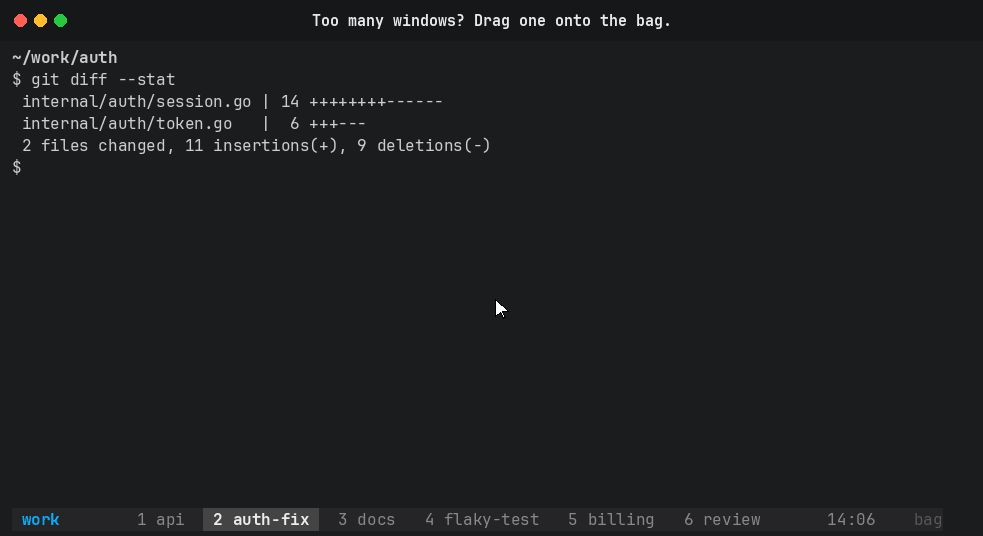

# tmux-bag

Drag a tmux window out of the status bar into a bag, and take it back out when you need it. The window list shows only what you're working on, and the bagged windows keep running.



## Usage

- **Bag a window.** Press a window in the status bar and drag it. A bag pops up at the right end of the status bar. Drop the window on the bag.
- **Open the bag.** Click `bag N` at the right end of the status bar, or press `prefix + B`. A tree of the bagged windows opens with a live preview of each one. Pick a window with the arrow keys and Enter, or press its number, to bring it back to the end of the current session. Press `x` to kill a bagged window instead.
- **Reorder windows.** Drop a window on another window in the status bar to move it there.
- **Use the keyboard.** `prefix + b` bags the current window.

To cancel a drag, release anywhere other than the bag or a window.

A bagged window keeps running: tmux-bag moves it to a detached session named `bag` and doesn't stop its processes. The `bag` session disappears once it is empty.

The button reads `bag 3!` when a bagged window rang the bell or printed nothing for 30 seconds. For a long-running task, either usually means it finished or is waiting for you. The tree marks those windows `bell` or `idle`.

tmux-bag won't bag a session's last window, because moving that window out would destroy the session.

## Requirements

- tmux 3.4 or later. 3.4 added the status line ranges the drop zone is built on. Tested on tmux 3.6b.
- `set -g mouse on` for dragging and clicking. `prefix + b` and `prefix + B` work without it.

## Install

With [tpm](https://github.com/tmux-plugins/tpm), add to `~/.tmux.conf`:

```tmux
set -g @plugin 'perzhul/tmux-bag'
```

Then press `prefix + I`.

Without tpm, clone the repository and run the plugin from `~/.tmux.conf`:

```sh
git clone https://github.com/perzhul/tmux-bag ~/.tmux/plugins/tmux-bag
```

```tmux
run-shell ~/.tmux/plugins/tmux-bag/tmux-bag.tmux
```

## Options

Set an option before the plugin line in `~/.tmux.conf` to override it.

| Option | Default | Description |
| ------ | ------- | ----------- |
| `@bag-key` | `b` | Key after the prefix that bags the current window |
| `@bag-open-key` | `B` | Key after the prefix that opens the bag |
| `@bag-session` | `bag` | Name of the session that holds bagged windows |
| `@bag-style` | `fg=colour214` | Style of the bag art and of the button when a bagged window needs you |
| `@bag-silence` | `30` | Seconds without output before a bagged window counts as idle; `0` turns the idle marker off |

## Uninstall

Remove the plugin line from `~/.tmux.conf`, press `prefix + alt + u` to let tpm delete the plugin, and restart the tmux server. tmux keeps the plugin's key bindings until the server restarts.

## Troubleshooting

- **Dragging does nothing.** Check `tmux show -g mouse` (it must be `on`) and `tmux -V` (it must be 3.4 or later).
- **The bag art stays on screen.** A release got lost, for example while switching terminal windows. Click the status bar or reload the config to clear it.
- **The `!` takes a few seconds to show up.** tmux redraws the status bar every `status-interval` seconds (15 by default).
- **A session switcher lists `bag`.** The bag is an ordinary tmux session, so `choose-tree`, sessionizer scripts and tmux-resurrect see it. tmux-resurrect saves and restores it like any other session.
- **The button is missing.** A theme plugin that sets `status-right` (catppuccin, dracula and others) replaces the button if it loads after tmux-bag. Put the tmux-bag plugin line after the theme's.
- **A bagged window's bell makes no sound.** tmux rings only the clients attached to a window's session, and nobody is attached to the bag. The `!` on the button is the signal instead.
- **Drag-to-swap stopped working.** tmux-bag binds `MouseDrag1Status` and `MouseDragEnd1Status` itself, which replaces a `swap-window` drag binding. Dropping a window on another window moves it there instead.

## How it works

- During a drag the status bar grows by two lines of bag art. With the status bar at the bottom, the art goes above your status lines; at the top, it goes below them. Your lines stay where they were, so the window list stays under the mouse. tmux-bag saves `status` and `status-format` when the drag starts and restores them when it ends. While the art is up, every pane is two rows shorter.
- The drop zone is a `range=user|bag` status range at the end of `status-right`. The button keeps the same width in every state, so the window list doesn't shift when a drag starts. tmux-bag raises `status-right-length` by 12 to fit it.
- tmux-bag wraps your `MouseDown1Status`, `MouseUp1Status*`, `MouseDrag1Pane`, `MouseDrag1Border` and `MouseDragEnd1Pane` bindings. The first load saves the originals, and each wrapper runs your original command when no drag is in progress. During a drag, crossing a pane does nothing, instead of starting copy-mode and losing the release.
- tmux can't report the mouse position over the status bar during a drag, so the bag can't light up on hover.

## Recording the demo

`demo/make-demo.py` records `demo/demo.gif`. It drives a private tmux server through a nested client, sends the same mouse events a terminal sends, and draws the pointer. It needs `pip install pyte pillow` and the JetBrains Mono font (`--font-dir` points at it).
